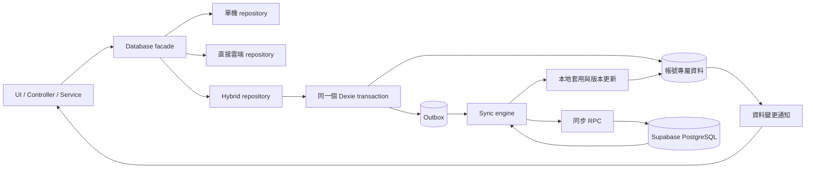

# 混合資料庫設計與分階段 Review

日期：2026-10-17；更新：2026-10-18（Asia/Taipei）

狀態：第五階段已交付 5A／5B／5C，5B 基本雙向同步人工驗收通過，5C 尚待人工驗收；同步 API 已於 2026-10-18 安裝至實際雲端。第六階段拆為 6A～6D，以下為待實作計畫，每個小階段完成後停止，等待使用者測試與 review 後指示繼續。

## 1. 工作範圍與控制規則

這份文件定義 Dexie 本地操作與 Supabase 雲端同步的建議方案。文件中的新行為均為待 review 的設計，不代表已實作或已獲使用者批准。

- 一次只執行使用者明確指定的一階段。交付後停止，收到下一階段指示才繼續。
- 使用者要求「繼續」只授權下一階段，不授權整個計畫。
- 每階段交付修改摘要、檔案清單、驗證結果、手動 review 步驟、限制及回退方式。
- 新需求或需要擴大修改範圍時，先交付原因與影響，由使用者決定。
- 保留現有單機模式與直接雲端模式；不自行更換預設模式或移除功能。
- 實際 Supabase 的 SQL 套用、資料搬移與部署，須另有明確授權。準備檔案與隔離測試不等於授權套用。
- 不自行 commit、建立分支、安裝新同步框架或執行無關重構。
- 第一階段只新增這份文件；不修改程式、skill、依賴、SQL 或實際資料。

## 2. 已檢視的現況

| 項目 | 目前狀態與證據 |
| --- | --- |
| 前端 | `package.json`：React 19、TypeScript 6、Vite 8，瀏覽器 SPA |
| 本地儲存 | `src/database/database.ts`：Dexie 4／IndexedDB，固定資料庫名稱 `travel-planner`，schema version 4 |
| 雲端儲存 | `src/database/supabase.repositories.ts` 與 `supabase.region.repository.ts`：Supabase repositories |
| 資料入口 | `src/database/index.ts`：依模式選擇一個 backend，沒有自動雙寫或同步 |
| 預設模式 | `database-mode-preference.ts`：沒有單機偏好時使用 Supabase |
| 模組分層 | UI → Controller → Service → Repository，適合在資料邊界加入 adapter |
| 操作延遲來源 | 地點更新有讀取、參照驗證、資料更新、關聯重建及可能的行程更新；畫面儲存後另有重新讀取 |
| 搬移功能 | `data-management.cloud-adapter.ts`：本地／雲端之間完整覆蓋，不是增量同步 |
| 覆蓋匯入 ID | `docs/supabase-phase2-safe-import.sql`：重新產生 UUID，不能作為持續同步 API |
| 權限 | repository SQL 採 member 私人資料、admin 全域存取、basic 無工作區權限；分享協作尚未開放 |
| 同步資訊 | 共用模型沒有版本、owner 與 tombstone；雲端主表有 `updated_at`，不足以涵蓋刪除與關聯變更 |
| 驗證工具 | Vitest 與 PGlite；PGlite 是開發測試依賴，不是目前本地正式資料庫 |

適用的架構 skill 已檢視：`.github/skills/travel-module-architecture/SKILL.md`、`.github/skills/supabase-platform-architecture/SKILL.md`，以及 Supabase skill。

Supabase 架構 skill 中「尚未整合登入／雲端存取」及共用資料權限描述已落後於程式；`docs/owner-isolation.md` 中部分搬移停用描述也與目前入口不同。本計畫以目前程式與版本化 SQL 為設計依據，實際雲端是否已套用仍未驗證。不以過時描述新增註冊、分享或權限行為。

目前未量測真實儲存延遲、API 請求時間或 PostgreSQL 查詢計畫，因此不宣稱已找出或改善實際資料庫效能瓶頸。

## 3. 建議採用的產品規則

以下規則是第一階段 review 的主要內容。

| 決策 | 建議 |
| --- | --- |
| 技術選型 | 保留 Dexie 與 Supabase，新增同步引擎；本計畫不引入 PowerSync、RxDB 或 WatermelonDB |
| 資料庫模式 | 保留 `indexeddb`、`supabase`，新增 `hybrid`；既有使用者不自動切換 |
| 同步模式 | hybrid 初次啟用預設手動；第六階段提供使用者可開關的自動同步 |
| 儲存完成 | 本地交易完成就顯示「已儲存於本機」，另顯示待同步狀態 |
| 差異預覽 | 手動同步預設顯示新增／修改／刪除明細，可選擇省略；版本檢查始終執行 |
| 衝突 | 不自動以最後寫入覆蓋；保留本地草稿與雲端版本，交由使用者處理 |
| 首次初始化 | 在線上驗證帳號權限後，以雲端自己的資料初始化獨立 hybrid 資料庫 |
| 舊單機資料 | 保留原資料庫，不自動認領或上傳；另行 review 匯入／合併方案 |
| admin | hybrid 第一版僅操作 admin 自己的資料；管理他人資料繼續使用直接雲端模式 |
| 備份 | hybrid 可匯出業務資料；整批匯入、清空與覆蓋搬移暫不開放於 hybrid，避免繞過佇列 |
| 離線範圍 | 已登入且工作區已初始化時，可離線操作資料；離線冷啟動／登入不在本計畫保證範圍 |

現有單機／直接雲端的備份入口保持原用途。v1 可攜備份不包含授權資訊或同步佇列；完整同步狀態復原需另行設計，不把業務備份當作佇列備份。

## 4. 資料流與責任邊界

模組仍透過原資料入口操作，不直接呼叫 Supabase 或 Dexie tables。驗證、參照檢查、交易與跨資料刪除規則留在 repository。同步生命週期屬於應用程式層級，不隨頁面模組切換重新建立。

現有 Supabase 查詢、欄位轉換及錯誤處理可重用。同步寫入使用專用 API，避免呼叫會另產生 ID、逐次更新關聯或缺少版本檢查的舊方法。

### 本地交易

一次邏輯操作必須在同一交易提交業務變更與 outbox。寫入 outbox 失敗時，業務資料也回滾；不允許先儲存成功再補記任務。

Outbox 記錄至少包含：帳號範圍、裝置 ID、操作 ID、佇列順序、操作類型、受影響資料、基準版本、payload、協定版本、重試次數與錯誤狀態。

地點關聯、刪除行程及其項目、整天排序與交通估時清除，都視為具相依性的操作群組。需記錄所有連帶變更，不能只追蹤 UI 直接修改的那一筆。

第一版保留操作順序，不任意合併或丟棄任務。效能優化以有界批次傳輸為主，佇列壓縮另行 review。

### 本地隔離

- hybrid 資料庫以 Supabase 專案識別與 user UID 區分，與舊 `travel-planner` 分開。
- 登出立即停止同步、清除畫面可見資料並隔離未完成工作；原帳號佇列不自動刪除。
- 重新登入同一帳號、通過權限檢查後才可恢復；另一帳號永遠不能接手上傳。
- 請求及回應綁定啟動時的帳號與執行世代。切換帳號後收到舊回應，不套用到新帳號。
- 本地資料庫名稱隔離不等於磁碟加密；共用瀏覽器的本地資料清除選項另行 review。

## 5. 雲端協定與一致性

第四階段設計及測試以下 API，名稱為暫定，尚未建立 SQL：

| API | 責任 |
| --- | --- |
| 初始化／snapshot | 回傳目前帳號一致的資料快照、版本與對應 cursor；不得拼接無共同邊界的多表讀取 |
| Pull | 分頁回傳 cursor 之後的新增、修改及刪除，包含關聯與連帶變更 |
| Push | 接收有界操作批次，檢查基準版本、授權及參照，在伺服器交易內套用 |

協定要求：

- 保留本地 UUID；ID 已存在但不屬於目前帳號時拒絕，不改寫他人資料。
- owner 由伺服器認證與父資料推導；客戶端 payload 不能決定授權、轉移 owner 或修改 ACL。
- 每個相依批次成功或完整回滾；回應區分成功、版本衝突、驗證錯誤及權限拒絕。
- 成功操作保存帳號＋操作 ID 的去重收據，重送同一操作回傳同一結果；相同 ID 不同 payload 拒絕。
- 雲端成功但回應遺失時，可安全重送；本地只在交易內套用成功回應後移除已確認任務。
- 送出期間新增的本地修改保留，成功回應不能覆蓋較新的本地內容或誤刪新任務。
- 版本是伺服器管理的 opaque token；不以裝置時間作排序或以 `updated_at` 單獨判斷衝突。
- 刪除必須留下可供離線裝置拉取的紀錄。紀錄清理期限與過期 cursor 的重新初始化策略，第四階段一併交付。
- cursor 必須有可證明不漏掉晚提交交易的順序保證；不能直接把 sequence 最大值當成已提交完整水位。
- 既有直接雲端 CRUD、排序 RPC、覆蓋匯入及清空也必須進入版本／變更追蹤；否則兩種模式無法共存。
- 新增表、函式及變更紀錄須驗證 member 隔離、basic／anon 拒絕與 admin 規則。優先使用保留 RLS 的 invoker；需要特權函式時另交付授權理由。

第四階段須先確認有效 schema、建立可重現的 migration 基線，再選定 cursor、追蹤、鎖定與收據保留的具體實作。尚未完成這些驗證前，不開放實際同步寫入。

### 一次同步流程

1. 取得同帳號跨分頁的同步鎖，確認工作區初始化、登入與權限。
2. Pull 雲端增量：沒有本地待修改的資料直接套用；有待修改的資料保留本地內容並記錄雲端候選版本。
3. 比較基準、本地與雲端。手動模式需要預覽時，在此交付明細；預覽不授權整批覆蓋。
4. Push 無衝突且相依條件完整的操作群組；伺服器在提交時再次檢查版本。
5. 在本地交易中保存成功回應、基準版本及佇列確認，再 Pull 最新結果並通知畫面。

多表變更的分頁需保留交易／操作群組邊界，避免本地看到缺少父資料的半套關聯。Pull cursor 只在變更與衝突資訊已持久保存後前進。佇列相依衝突時暫停相依任務，互不相依的群組可繼續。

## 6. 衝突、失敗與觸發

| 狀況 | 行為 |
| --- | --- |
| 只有本地變更 | 以基準版本上傳 |
| 只有雲端變更 | 套用本地並更新畫面 |
| 同筆雙方變更 | 保留兩份資料，暫停相依任務，顯示衝突 |
| 修改與刪除衝突 | 不自動復活；採雲端結果或明確建立新資料，重新驗證相依關係 |
| 使用者採本地內容 | 基於最新雲端版本建立新的操作，再驗證；不直接跳過版本檢查 |
| 使用者採雲端內容 | 明確確認放棄該本地變更，處理相依任務後套用 |
| 網路中斷／timeout | 保留佇列，採有上限與 jitter 的退避重試 |
| 權限拒絕／資料不合法 | 停止該任務重試並顯示原因；不標成同步成功 |
| 多分頁／舊 worker | 共享鎖或 lease 防重入，伺服器操作去重作最後防線 |
| cursor 過期 | 保留待同步資料，要求受控重新初始化與衝突 review，不清空本地後硬覆蓋 |

狀態至少區分：初始化中、已儲存於本機、待同步、同步中、已同步、離線、衝突及同步失敗，並提供待處理數量與最後成功時間。儲存失敗與同步失敗分開顯示。

第六階段採事件驅動同步＋定期補拉＋退避重試：本機交易成功後 2 秒 debounce，連續修改最長 10 秒觸發；開啟自動模式、恢復連線及回到前景時同步，前景每 4 分鐘補拉雲端變更。網路錯誤採有上限的指數退避＋隨機延遲，權限錯誤不無限重試。上述秒數是初始參數，不是業界固定標準，可依量測調整。

手動與自動同步共用既有引擎、版本檢查、安全重送、跨分頁鎖與帳號隔離；第一版沿用現有 Supabase RPC。手動模式不背景同步；登出、切帳號或切手動時停止排程。全站提供衝突警告與處理入口，發現衝突立即暫停自動同步，沿用 5C 整批衝突處理，處理完成後可恢復。下載後刷新資料畫面時須保護未儲存表單草稿。

`visibilitychange`／`pagehide` 僅嘗試同步；`beforeunload` 用於未同步提醒。瀏覽器關閉、背景節流或裝置休眠時不保證執行，下次開啟以持久佇列恢復。Google Maps／Places／Routes 等外部服務仍需要網路；本地資料操作加速不代表外部 API 也可離線。

## 7. 分階段修改與驗收

以下為預計檔案範圍，新檔名可在該階段實作前細化；跨出範圍須先說明。

| 階段 | 預計修改範圍 | 必須交付的驗收證據 | 回退與限制 |
| --- | --- | --- | --- |
| 1 設計定案 | 僅本文件 | 決策、資料流、範圍與 review 清單 | 移除文件即可；不改執行行為 |
| 2 本地同步基礎 | `src/database/database.ts`、`repositories.ts`、`label.repository.ts`；新增帳號 context、同步 types／儲存及 focused tests | 獨立資料庫；資料與任務同交易、失敗回滾；刷新持久性；帳號隔離；連帶變更可追蹤 | 不接正式 UI、不連同步 API；舊單機資料保留。只做本地初始化標記，雲端初始化屬第五階段 |
| 3 混合模式本地操作 | database facade、runtime／mode preference；hybrid adapter；必要 Auth／模式 UI 接線與測試 | 測試入口可操作五種實體；驗證／刪除／排序規則保留；業務 CRUD 不發出雲端寫入；操作延遲量測 | 僅開發測試入口，不更換預設；回到原模式不清除 hybrid 佇列，不代表已同步 |
| 4 雲端同步 API | migration 基線及新增同步 migration；同步 cloud adapter；PGlite／協定 focused tests；相關架構文件與 skill 更正 | UUID、原子批次、版本衝突、刪除、關聯、去重、晚提交 cursor、RLS、舊雲端入口追蹤測試 | 先隔離驗證；實際 SQL 另需批准。停用同步可回退應用，SQL 回退須另外評估與備份 |
| 5 手動雙向同步 | sync engine／初始化；資料管理 controller／service／UI；應用 sync provider；資料通知及測試 | 一致 snapshot；差異預覽；兩裝置更新／刪除；離線重送；回應遺失；送出期間新修改；帳號切換／多分頁；衝突處理 | 通過隔離驗收並獲實際環境授權後才正式開放 hybrid；舊單機合併不含於本階段 |
| 6 自動同步 | 同步排程器、生命週期及設定 UI；focused tests | 開關、debounce、週期、前景／連線恢復、不重入、失敗可恢復、手動模式完全不背景傳輸 | 關閉自動即可回到手動；不增加 service worker 或 PWA 冷啟動承諾 |

### 第六階段小任務與驗收

目前架構為 **React → repository → Dexie 本機資料＋待同步佇列 → 同步引擎 → Supabase RPC**。手動同步已有版本檢查、安全重送、跨分頁鎖與帳號隔離，第六階段直接沿用。

**依序執行 6A → 6B → 6C → 6D；每個小階段完成後停下，讓使用者測試與 review，收到繼續指示才進入下一個小階段。** 本次僅更新文件，不代表已實作第六階段。

| 階段 | 實作內容 | 使用者驗收重點 |
| --- | --- | --- |
| **6A：模式與全站警告** | 新增自動／手動切換、保存偏好，預設手動；全站顯示衝突警告與處理入口。此階段自動選項先標示尚未開放 | 刷新保留設定；在其他頁面也能看到衝突並前往處理 |
| **6B：基本自動同步** | 開放自動模式；本機交易成功後 **2 秒 debounce、連續修改最長 10 秒觸發**；與手動同步共用引擎與鎖 | 修改後自行上傳；快速連續修改不密集發請求；手動模式不背景同步 |
| **6C：生命週期與重試** | 開啟自動模式、恢復連線、回到前景時同步；前景每 **4 分鐘**補拉雲端變更；網路錯誤採有上限的指數退避＋隨機延遲 | 離線修改保留，連線後恢復；登出／切帳號／切手動停止排程；權限錯誤不無限重試 |
| **6D：畫面與衝突整合** | 下載後刷新資料畫面並保護未儲存表單；衝突立即警告、暫停自動同步，接回既有整批衝突處理 | 兩瀏覽器修改同筆資料不互相覆蓋；處理完衝突可恢復；表單草稿不被刷新清掉 |

觸發方案採事件驅動同步＋定期補拉＋退避重試。時間參數為初值；第一版沿用現有 RPC。瀏覽器關閉或休眠期間無法保證同步，重新開啟後靠持久佇列恢復。

第二階段若需讓 repositories 注入資料庫實例，只做支援既有單機與新增帳號資料庫所必需的調整，不重寫業務模型。現有直接雲端讀寫保留；第四階段只補上共存所需的追蹤及必要原子操作。

程式階段執行相關 focused tests，影響 TypeScript／UI 時執行 build 與 lint。除非使用者另要求，不執行全套驗證。實際雲端、瀏覽器或跨裝置測試未執行時明確標示，不以 mock／PGlite 結果代替。

每階段交付格式：

1. 本階段完成內容與修改檔案。
2. 已跑檢查、結果、未跑項目。
3. 使用者 review 操作與預期結果。
4. 限制、回退方式及未完成事項。
5. 下一階段的具體範圍；停止等待使用者指示。

## 8. 第一階段 Review 清單

### 登入時的空裝置檢查（2026-10-18）

本次使用者授權的增量行為：混合模式在角色驗證及帳號本地資料庫準備完成後，
先比對雲端快照與本機狀態，再讓業務頁面首次載入。責任留在共用同步引擎與
hybrid runtime；AuthProvider 只在帳號啟動時銜接，不依賴資料管理模組。

- 已一致或本機非空且沒有衝突：登入檢查不改動業務資料，不新增自動上傳。
- 所有業務資料皆空且沒有任何 outbox 操作：驗證並下載目前帳號的雲端快照，
  原子更新資料、版本與游標；有待同步刪除時不視為新裝置。
- 發現版本衝突：保留業務資料、標記既有佇列衝突，沿用全站資料管理連結及
  衝突處理流程；不選擇任一版本覆蓋。上傳結果未確認的操作保留安全重試狀態。
- 比對／網路失敗：不清除本機資料或登出，顯示同步錯誤與資料管理重試入口。
- 沿用跨分頁 Web Lock、帳號世代防護及交易內本機狀態重查。登出、切換帳號
  後的舊回應不可套用；同帳號 token 更新與一般分頁切換不重跑登入初始化。
- 不改單機／直接雲端模式、既有後續同步排程、SQL 或實際雲端設定。

已依使用者授權執行 `sync-engine.test.ts` 與 `hybrid.backend.test.ts`：
共 29 個測試通過。Node.js 20 初次執行因未啟用原生 WebSocket 而未載入案例，
加上 `NODE_OPTIONS=--experimental-websocket` 後通過，未新增套件。
未執行 build、lint、瀏覽器或實際跨裝置驗證，不代表已通過跨裝置人工驗收。

- [ ] 採 Dexie＋Supabase，保留三種模式，現有預設不變。
- [ ] hybrid 預設手動同步，差異預覽可省略，衝突檢查不可省略。
- [ ] 雙方修改由使用者處理，不採無條件最後寫入覆蓋。
- [ ] 首次使用先從雲端初始化；舊單機資料不自動合併。
- [ ] hybrid 第一版限目前帳號自己的資料；admin 管理他人資料使用原雲端模式。
- [ ] hybrid 第一版提供匯出，整批匯入／清空另行 review。
- [ ] 離線冷啟動、共享協作、舊資料合併及新同步框架不在六階段範圍。
- [ ] 每階段停止 review，實際雲端套用另行批准。

核准紀錄：使用者表示「暫時看不出問題 開始做第二步」，接受本設計作為第二階段依據。清單保留供後續回顧。
更新：使用者第二階段驗證通過後指示「開始用」，已授權第三階段。交付見 [第三階段 Review](local-first-sync-phase3-review.md)。
更新：使用者表示「測試完成 請繼續」，授權第四階段隔離實作；交付見 [第四階段 Review](local-first-sync-phase4-review.md)。
更新：使用者表示「開始下一步吧」，授權第五階段；之後指示繼續下一步。已交付 5A 唯讀預覽、5B DEV 手動初始化／雙向同步及 5C 整批衝突選擇；5B 基本雙向同步人工驗收通過，5C 尚待人工驗收。見 [第五階段進度](local-first-sync-phase5-review.md)。

第二階段交付與驗收見 [本地同步基礎 Review](local-first-sync-phase2-review.md)。

## 9. 本階段驗證與參考

2026-10-18：使用者明確授權目前 Supabase 安裝同步 API；已比對現有結構、備份業務資料／相關定義、僅套用 sync migration 並驗證實際 SQL API（測試寫入回滾）與 PostgREST 未登入拒絕。未重播 baseline 或修改 migration history。詳見第五階段 Review 的實際雲端安裝紀錄；完整瀏覽器／跨裝置驗收仍待執行。

本階段僅進行 repository／skill 閱讀、設計一致性檢視與文件 diff 檢查。未執行 build、lint、測試或雲端查詢，未變更執行行為。

框架評估參考：

- [WatermelonDB 同步觸發與 frontend 協定](https://watermelondb.dev/docs/Sync/Frontend)：呼叫時機仍由應用程式負責。
- [PowerSync 與 Supabase](https://docs.powersync.com/integration-guides/supabase)：需要 SQLite 遷移、同步服務及上傳整合。
- [RxDB Supabase replication](https://rxdb.info/replication-supabase.html)：提供 replication，但仍需評估既有跨表業務交易。
- [Electric Sync](https://electric-sql.com/docs/sync)：主要是 read-path sync，寫回仍需設計。
