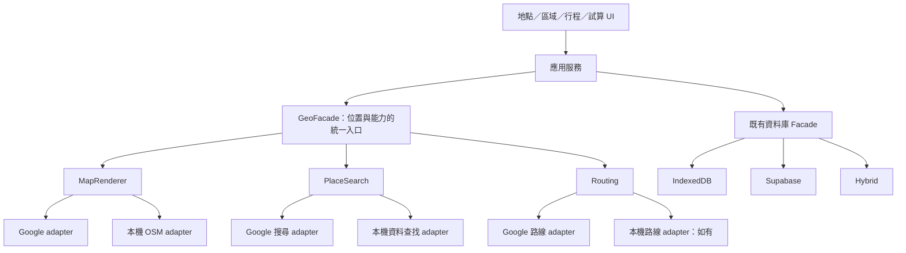

# Google Maps／本機 OSM 抽換初步評估

評估範圍：目前 Travel 工作區的程式、型別與 migration；尚未讀取另一個 OSM 專案，也未查詢實際 Supabase 或瀏覽器 IndexedDB 資料。本文件是架構建議，不表示已實作、部署或完成資料轉換。

## 結論

建議保留本專案，增加地圖統一門面與 provider adapter，逐步讓資料及業務邏輯不依賴 Google。可以使用隔離分支／worktree 開發，沒有必要維護兩份產品專案。

理由：資料層已有 IndexedDB／Supabase／hybrid 三種來源的 facade；行程、標籤、關聯、權限及同步機制有大量可沿用的邏輯。Google SDK 操作也已集中成單一服務，適合包成 adapter。真正的工作量主要在「座標未持久化」與「Google place ID 被當成跨層識別」，不是底圖元件本身。

只把 `google-places.service.ts` 的函式換成 OSM 實作，仍會留下 Google ID、搜尋元件與資料格式的假設，無法達成良好抽換。

## 現況與證據

| 範圍 | 現行行為 | 影響 |
|---|---|---|
| Google SDK | [google-places.service.ts](../../src/modules/place/google-places.service.ts) 共 417 行，集中 loader、搜尋 widget、details、Routes、map／markers | 可作為 Google adapter 的起點；搜尋與地圖目前都先載入 Places |
| 地點資料 | [models.ts](../../src/database/models.ts) 的 Place 只有名稱、Google ID／網址、筆記與關聯，沒有座標 | 有存地點，但不等於有存可供 OSM 畫圖的座標 |
| 舊資料升級 | [database.ts](../../src/database/database.ts) version 3 會刪除 Place 的 latitude／longitude；沒有 ID／網址时先將座標或名稱轉成 Google 搜尋網址 | 舊座標可能部分保留在網址；不能假設目前資料庫仍有原欄位 |
| 區域 | Region 有 optional center；[RegionModule.tsx](../../src/modules/region/RegionModule.tsx) 選 Google 結果後將 draft.center 清空，儲存時優先寫 ID | 既有區域也可能只存 Google ID |
| 行程地圖 | [itinerary-map.service.ts](../../src/modules/itinerary/itinerary-map.service.ts) 即時查 Google details；只有網址的地點列為無法定位 | 不能直接改底圖就做到本機讀庫畫圖 |
| 路程試算 | [route-calculator.service.ts](../../src/modules/route-calculator/route-calculator.service.ts) endpoint source 為 saved／google；marker 與起終點用 Google ID | 高耦合，需要改成專案識別與座標 |
| 已存試算地圖 | RouteMap 存 origin／destination Google ID；RouteMapPlace 存 Google ID，沒有座標 | 額外標記也需轉換，不能只補 Place |
| 時間與距離 | [itinerary.service.ts](../../src/modules/itinerary/itinerary.service.ts)、[shared-trip.service.ts](../../src/modules/itinerary/shared-trip.service.ts) 用 Google Routes；行程項目保存分鐘／公尺 | 數值欄位可沿用；需收斂計算、失效與位置變更檢查。獨立試算結果未持久化 |
| 資料門面 | [database/index.ts](../../src/database/index.ts) 選 IndexedDB／Supabase／hybrid backend | 值得保留，地圖 provider 不應決定資料庫模式 |
| 備份與分享 | backup、共享 document、公開 snapshot 與 SQL RPC 有欄位白名單及手動欄位組裝 | 新增座標不會自動通過所有路徑，須一起更新 |

文字盤點共有 **35 個非測試、非 CSS 的 src 檔案**涉及 Google ID／型別／服務等相關字串。這是接觸範圍，不表示 35 個檔案全部需要大改。

## 可沿用的部分

| 部分 | 沿用判斷 | 必要調整 |
|---|---|---|
| Trip、Label、地點與區域／標籤關聯、行程排序 | 高 | 原則上保留既有 UUID、外鍵與操作 |
| Supabase Auth、owner／member 權限、RLS 基礎 | 高 | 更換地圖不需要更換登入系統；新欄位仍在既有權限邊界内 |
| IndexedDB／Supabase／hybrid facade | 高 | repository 映射與驗證加入位置欄位 |
| 本機交易、outbox、同步 engine、帳號隔離、receipt | 高 | engine 大致沿用；payload、雲端 RPC、baseline／舊待送任務相容性須檢查 |
| Region.center | 高 | 可直接作為中立座標，之後讀取優先使用已存 center |
| Place | 中 | 補獨立位置；放寬目前必須 Google ID 或網址的條件 |
| RouteMap／RouteMapPlace | 中低 | 移除 provider ID 作為標記身分的假設，補位置與中立端點 |
| 備份、共享、公開行程 | 中 | 前後端欄位白名單、序列化、匯入與版本相容性一併調整 |
| UI 外殼、CRUD、標籤、行程表單 | 高 | 保留版面；抽換搜尋、地圖 host、能力提示與 provider 文案 |

「最小改動沿用資料庫」可行；「完全不改 schema」無法完整支持本機座標與所有現有功能。

## 建議的門面

一個入口對應三種獨立能力：**底圖顯示、地點查找、路線計算**。OSM 是資料來源，另一個專案究竟提供哪些能力，要看它的 renderer、資料檔與運算方式。

### 中立契約

- `Coordinate`：WGS84 `{ latitude, longitude }`。renderer adapter 才轉成 Google／Leaflet 的 lat/lng 或 GeoJSON／MapLibre 的 `[longitude, latitude]`。
- `MapRenderer`：mount、setMarkers、fitBounds、destroy；需要點圖選位時再提供 callback。既有 GoogleMapHandle 已有 setMarkers／destroy，容易抽出。
- `PlaceSearch`：search、可選的 resolve。回傳中立名稱、位置、地址及來源 reference；共用 React 搜尋 UI，避免業務服務掛載 Google DOM widget。
- `Routing`：以起終點座標與交通方式計算，回傳 durationMinutes／distanceMeters；可選 geometry。Google adapter 可在內部使用仍有效的 Google reference。
- `capabilities`：分別表示可顯示底圖、可搜尋、可反查地址及支援哪些交通方式；不能用單一「API key 是否存在」控制全部功能。
- provider 的 attribution 與外連網址由 adapter 提供；錯誤分類中立化，不讓 UI 讀 provider 原生 exception 或全域物件。

建議依需求提供一套預設 provider 配置，初期不做龐大的動態外掛系統。底圖切換也不應偷偷回退 Google 搜尋／路線；本機模式要能明确禁止 Google SDK 和網路請求。

### 位置與身分

- Place.id 保持專案 UUID；位置為 optional（相容舊資料），新建可定位地點需要有效座標。
- provider reference 為 optional 補充欄位，像 `{ provider: 'google', id: '...' }` 或 `{ provider: 'osm', id: 'node/...' }`；OSM reference 須分辨 node／way／relation。
- 不把 OSM ID 塞進 `googlePlaceId`，也不以座標作主鍵：同座標可能有不同地點，地點也會搬移。
- 保存座標來源，至少區分使用者選位、本機資料與外部查詢；外部結果是否可永久保存／跨底圖使用，待查當時 provider 條款後決定。
- RouteMapPlace 使用自己的 UUID 作 marker ID，保存位置與名稱；可選关联 Place.id，允許臨時點不新增收藏地點。
- RouteMap 起終點指向中立 endpoint，需能同時表示原行程地點與額外標記。具體用引用或位置 snapshot，待 OSM 專案對照後定稿。
- 現行 transport 字串可先沿用，在 adapter 内映射並用能力清單限制，不必同時更改全部資料列。
- 時間／距離沿用原欄位；共用位置版本／指紋判斷失效，涵蓋座標變更、前站／後站／交通方式變更與非同步回傳競態。可補來源 metadata；切換 provider 不直接覆蓋已存結果。

## Supabase 與 IndexedDB 調整邊界

### Supabase

沿用現有 tables 與關聯，使用增量 migration 增加位置與中立 reference／endpoint。Place 現有 CHECK 只接受 Google ID 或 maps_url，新增「有效位置」也需要通過；RouteMapPlace 的 NOT NULL 與 `(route_map_id, google_place_id)` 唯一條件需要中立化。

單纯存點並畫圖，先使用普通座標欄位即可；尚無證據需要引入 PostGIS。若需要資料庫範圍／半徑／最近地點查詢，再評估空間索引。欄位型別与位置成對、範圍驗證需在正式 schema 設計時定稿。

需一起檢查的 SQL 接面：

- `sync_private.record`、`app_sync_snapshot`、`app_sync_push`：序列化、欄位白名單與 upsert。
- `app_backup_assert_payload`、preview／apply 匯入與 signature：新欄位、端點引用與匯入 ID 重映射。
- `collaboration_private.shared_document`、`app_shared_trip`：共享地點複製、驗證、去重與路程失效。
- `app_cancel_shared_trip`：轉回私人地點時保留位置。
- `public_itinerary_private.validate_snapshot`／`api`：公開 snapshot 驗證及套用時寫回位置。

repository 中也有手動 camelCase／snake_case 映射，不能只改 TypeScript 型別。上線前需確認实际 schema 與 migrations 一致，不能由檔案推斷已部署狀態。

### IndexedDB

Dexie 記錄可增加不索引的欄位，單純補位置不一定需要索引升級；但 routeMapPlaces 目前以 Google ID 建立唯一索引，改端點與索引需要 migration。版本選擇必須涵蓋繼承的 SyncDatabase；目前 TravelDatabase 已宣告 version 10，SyncDatabase 又宣告 5／6／8／9，不能依較舊架構文件的 7／9 直接選下一版。

須涵蓋 standalone DB、各 project／user hybrid DB、shared cache，以及獨立的公開 catalog DB。保留舊資料与待送 outbox，新增讀取正規化和舊格式相容；不靠重建資料庫完成換圖。

備份目前接受 version 1／2 且禁止未知欄位；公開 snapshot 為 schemaVersion 1。先採向下相容讀取、再決定新版寫入與服務端 rollout，避免升級一邊後另一邊拒收座標或默默忽略欄位。

## 舊資料轉換

1. 先做唯讀資料盤點：有 center／可確認座標網址／只有 Google ID／只有名稱或網址，各有多少筆；包含私人地點、區域、試算標記、共享及公開 snapshot。
2. 有可靠既存座標者先沿用。Google URL 中 `query=lat,lng` 可作候選；`@lat,lng` 常是視角中心，不能直接當成店家座標。
3. 只有 Google ID 者無法離線推導座標。優先由本機 OSM 資料或人工選位配對；若採 Google 查詢，另確認資料保存／跨底圖條款、費用與使用者授權範圍。
4. 名稱搜尋有歧義，不自動以第一筆覆蓋；保存未定位清單與候選，讓使用者確認。
5. 分批、可重跑、可回報進度；保留舊 Google ID／網址作相容資料，使用既有 repository／同步路徑保存變更。
6. 將「未定位」視為可保存的舊資料狀態；地點、筆記與行程仍可查看，僅受影響的圖釘／路線功能提示補位置。

## 分階段落地與驗收

| 階段 | 交付 | 驗收重點 |
|---|---|---|
| 1：对照本機專案 | 確認 renderer、座標、資料入口、搜尋與 routing 能力，定稿契約 | 用少量手動座標做 marker／點選／fitBounds，確認本機資源載入 |
| 2：抽出中立門面 | Google adapter、共用 Geo 型別、MapView／位置解析／路程服務 | Google 既有功能仍通；UI／domain 不再依賴 Google 原生物件 |
| 3：增量資料調整 | 座標、reference、endpoint、映射、驗證、同步／備份／分享相容 | IndexedDB／Supabase／hybrid 完整往返，不丟欄位或待送任務；權限隔離仍有效 |
| 4：接 OSM 與補舊位置 | 本機 adapter、查庫搜尋、點圖選位、未定位管理 | 無 Google key 仍讀庫畫圖；允許本機資源、攔截外部地圖請求後功能正常 |
| 5：切換與收斂 | provider 選擇、能力提示、移除殘留 API 強制檢查 | 同一份地點／行程資料可切兩種地圖，無重新建檔需求 |

重要測試包括：新增地點離線重開後仍有圖釘；換圖不改 UUID 與行程引用；座標變更清除受影響路程；搜尋／路線不支援時仍可 CRUD；備份、雙向同步、共享启用／取消、公開發佈／套用都保留位置；舊 snapshot／backup／outbox 可正常讀取。

估量為中等以上重構：UI 地圖適配較小，地點／端點模型與跨儲存路徑較大。未看 OSM 專案与資料完整度前，無法給可靠工期；底圖 PoC 與完整兩 provider 共用資料應分開估算。

## 與 clone 的比較

| 策略 | 短期 | 長期 | 建議 |
|---|---|---|---|
| 原專案建立門面 | 要先處理中立模型與相容性 | 一份业务邏輯、資料與修正 | 最符合可抽換地圖的目標 |
| clone 後直接改 OSM | 可能較快移除 Google UI，但資料轉換仍不能省 | 兩份同步、分享、權限與 schema 演進要維護 | 只適合確定要独立產品且不再兼容 Google |
| 隔離分支／worktree 做 PoC | 小範圍驗證 renderer 與資料流 | 完成後可整合回主專案 | 建議用於下一階段驗證 |

## 下一個專案需確認的資訊

提供專案位置後可直接查：renderer／框架、座標格式、圖資來源与覆盖、是否讀本機檔案或本機 HTTP 服務、POI 搜尋與反查地址、路線交通方式、點圖選位、可否封裝成 library／component，以及授權 attribution。

「不用外部地圖 API」與「整個產品完全離線」是不同範圍。現有 Auth、Supabase 同步与部分協作管理仍需連線；本機底圖可獨立達成，若要離線冷啟動登入需另外評估。
